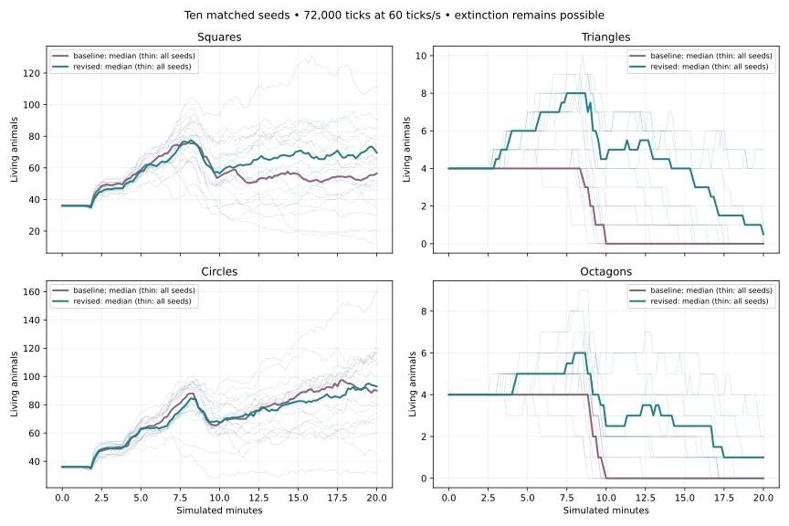
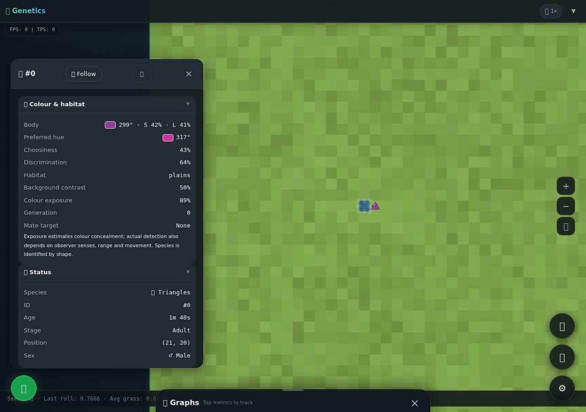

# Predator extinction: evidence and remaining limits

## Executive finding

Corrected main repeatedly loses predators primarily through **failed demographic replacement, not an inability to make kills or global prey exhaustion**. Across ten 72,000-tick observations, 80 predator founders produce just 11 offspring; 77 of 91 predator deaths are age and 14 thirst. Neither predator species reaches a sampled generation above one, and both disappear in every seed by twenty minutes.

The strongest confirmed behavioral defect is premature interruption of available resource recovery. Relative hunger/thirst scores can send an animal away after a meat bite or partial drink while the competing reserve is safe. Predators then spend much of their lives below breeding condition, despite obtaining prey. A second, reproduced opportunity barrier suppresses visible courting below appetite even when the configured physiological breeding requirements are met and no meal/drink is immediately available. Blind search also discards previously observed social locations, amplifying low-density isolation.

The PR repairs those mechanisms, adds bounded observed contact memory and corrects feeding/predation accounting. Initial population remains **80, including four triangles and four octagons**. Hunting speeds/ranges/chances, carcass yield, food nutrition, reproductive eligibility, conception chance, gestation, cooldowns, lifespan and offspring sex rules remain unchanged. There are no population floors, respawns, forced births or count controllers.

Results improve substantially, but **this is not a solved equilibrium**. Predator births rise from 11 to 112 by twenty minutes. Triangle census extinction falls from 10/10 to 5/10 runs; octagon extinction from 10/10 to 3/10. Only two triangle populations and one octagon population retain both sexes at that endpoint. Many other survivors are reproductively stranded single-sex groups or singletons. The extended seed-1 run loses both species. Those failures are included below.

## Baseline identity and protocol

- Baseline: `4fab12610d42b03dc9dc9570cbb1b93a7dbb220e`, current main at investigation/submission preparation, including PR #138 review correction `32de086`.
- Read PRs #135–138, standing agent/context/architecture guidance and current source. No old track report was treated as authoritative behavior.
- The original submitted #138 snapshot recorded 26 / 21 / 17 kills at ten minutes. Corrected main instead reproduces **17 / 13 / 11** and populations **119 / 164 / 156**. All comparisons here use corrected main, not the original submission.
- Ten seeds were selected before the final mechanism: **1, 2, 3, 7, 19, 42, 73, 101, 1337, 2026**.
- Three familiar seeds first ran 36,000 ticks. All ten have at least 72,000 ticks (1,200 seconds, twenty minutes, 2.22 nominal 540-second lifespans); seed 1 ran 144,000 ticks on both revisions (forty minutes, 4.44 nominal lifespans).
- Baseline forty-minute execution cost about 1,286 seconds on the shared runner, motivating one extended seed rather than thirty forty-minute runs. Other long jobs used independent processes. Timings include diagnostic/concurrent workload and are not app tick benchmarks.
- The paired table uses exactly 72,000 ticks for every seed. Births are derived by species conservation from initial/end populations and exact death events, so seed 1's extra twenty minutes cannot inflate the common-horizon comparison.
- Ten-second snapshots describe trajectories/sex/condition/generation/separation; removal events supply exact extinction times. Sampled population/generation peaks can miss short transients. Raw trait distributions and predator histories are archived compactly; commands regenerate full telemetry.
- Matched seeds do not preserve counterfactual trajectories after altered decisions change RNG consumption. Mechanism regressions and one-factor/interaction experiments support causality; no statistical-significance or universal-balance claim is made from this convenience sample.

### Observational validity and replay

The external observer exactly matches all three stored corrected-review full creature/summary hashes. Final independent soak runs likewise exactly match the recovery pilot's complete hashes:

| Seed | Corrected-main hash                                                | Final 36,000-tick hash                                             |
| ---- | ------------------------------------------------------------------ | ------------------------------------------------------------------ |
| 1    | `bb31d4f1b54418fbe6f9a6d71f676086a568b82db7e56ec67d450e40b8e5d4ff` | `d2d6a9cd843dcc660db7a5d2509df76848455189654d61dd562b83f437f48e87` |
| 42   | `2984d488497e141327a0f5c6eb94b6458005ed0335a73dec36fca33102e43e60` | `edb62a1d60c830e06a46d4ecded50306094433d3e544764f4399e7a156377618` |
| 1337 | `77ff8db5105f54e3b896a412dae63ad61983e491db3eb8298b78bad5edabc928` | `5e3c1e57820ec9d9b37ada7ba48e3ccd7dcab71f7dc349cf78f5ba76f56e4e68` |

## Causal findings and implementation

### 1. Available resources were interrupted before adequate recovery — confirmed behavior defect

At default triangle efficiency, one meat bite gains approximately `0.55 / 60 × 4.5 × 1.3 = 0.0536` energy, exceeding the 0.05 need-switch margin. Switching after such a bite can abandon a carcass even though water is safe. Drinking has the reciprocal problem. Merely seeing kills in telemetry obscured the difference between catching prey, consuming meat and recovering sufficiently to breed.

Three new tests fail on the prior implementation: a meal at 55% energy/50% water switches to drinking; drinking at 50% energy/55% water switches away; finite colocated resources fail to restore normalized reserves above 90%. The correction continues the currently available drink/meat episode toward the existing meter's near-full capacity (configurable target 0.95, at least individual appetite). It yields to a competing reserve at/below half its inherited threshold, to resource exhaustion, and to existing threat/movement rules. It creates no resource or energy. Grass/berry meal thresholds stay unchanged.

The threshold-only experiments did not fix relative-priority interruption. The final fix changes the actual action arbitration, rather than increasing nutrition, yield, speed or catch probability. Recovery has ordinary opportunity costs: time at a resource, possible crowding/competition, and changed travel/mating timing. Water recovery also affects herbivores, so every species is reported.

### 2. Mating opportunities and social information — confirmed barrier plus supported behavioral limitation

A healthy mature pair at 72% energy, above the configured 70% reproductive minimum, previously performs food searches rather than courtship at three tiles separation. It now courts a visible eligible partner when no immediate meal/drink is available. Hungry blind mate search remains restricted. Real sex, maturity, meters, cooldown, visibility, commitment and conception requirements still govern births.

Predator partners often separate by tens of tiles; simply being globally present is insufficient. Contact memory records only visibly observed opposite-sex conspecific positions, at most four entries and one observation refresh per second. Healthy search can revisit a reachable observation before blind exploration. Visits and expiry discard unsuccessful leads; hidden live coordinates, death state or fertility are never remotely read to update a contact. Existing live candidate choice still uses colour preferences.

Contact-only runs did not establish a population benefit. This is a cognition/encounter mechanism with stale-information costs, not a survival guarantee. Its interaction with sufficient reserves is important: searching meaningfully requires time above breeding condition. A zero-memory ablation is retained; results vary by seed rather than proving a universal advantage for memory.

### 3. Founder and life-history sensitivity — supported demographic risk, not compensated by a floor

Four founders per species mean only two females, asynchronous healthy periods and a substantial risk of partner/sex loss. Founder deaths cluster because all start at age zero. However, doubling predator founders on broken main (holding 72 herbivores via total 88/predators 16) and distributing initial ages do not prevent long-run extinction. Neither change was adopted to conceal the resource defect.

Default gestation/cooldown/maturation can produce multiple generations in controlled favorable conditions. Stationary, explicitly food/water-accessible pairs use real actions, metabolism, aging, conception, inheritance and death on finite meat. The final fixture reaches generation two, with six births and five surviving descendants at ten minutes; baseline reaches generation three with six births and five survivors. This isolates functioning reproduction, not wild equilibrium or an improvement in that fixture. The stronger final evidence is new wild generations described below.

### 4. Mortality/feeding statistics — confirmed accounting defects and gaps

Catches previously killed through HP zeroing, then counted as injury; coincident lifespan expiry could instead label the same event age. Combat now marks explicit lethal predation, and death classification gives that event precedence. Non-event simultaneous conditions retain explicit age → injury → thirst → starvation precedence. Global/species counters and UI summaries agree.

Actual consumed units, capped gross energy and feeding ticks are counted per species/food in actions. Empty carcasses never receive credit. Baseline `nutrition.positiveEnergy` is a positive **net tick-meter increment**, not exact gross intake; it must not be relabeled as consumed meat. Baseline injury counts include predation, whereas revised predation is separate.

## Controlled experiments and rejected alternatives

The following are predator births (triangles / octagons) at 36,000 ticks unless labelled otherwise. Complete raw outputs and source patches are archived; unfavorable results are retained.

| Variant                                                | Seed 1    | Seed 42   | Seed 1337 |
| ------------------------------------------------------ | --------- | --------- | --------- |
| Corrected main                                         | 1 / 1     | 1 / 1     | 2 / 0     |
| Longer meat meal threshold only                        | 0 / 1     | 2 / 0     | 0 / 1     |
| Longer drinking threshold only                         | 0 / 1     | 0 / 0     | 0 / 0     |
| Both stopping thresholds only                          | 0 / 0     | 0 / 0     | 0 / 1     |
| Visible courtship opportunity only                     | 0 / 0     | 2 / 0     | 0 / 1     |
| Contact/courtship, final reachability version          | 0 / 0     | 1 / 0     | 2 / 0     |
| Contact + stopping thresholds, without priority repair | 0 / 0     | 0 / 5     | 0 / 1     |
| Final recovery arbitration + courtship/contact         | **5 / 2** | **6 / 2** | **4 / 2** |
| Final recovery, contact memory disabled                | 3 / 3     | 0 / 4     | 1 / 0     |
| 16 founders on main, total 88                          | 2 / 3     | 1 / 1     | 3 / 3     |
| Mixed founder ages on main, 72,000 ticks               | 1 / 1     | 2 / 4     | 1 / 1     |

The early `contact-memory` file predates the unreachable-contact check and differs from the final contact-only version. It is historical experimental evidence, not a final outcome claim. Source patches make the distinction reproducible. The unpowered colour tests on baseline seed 42 give 1 / 1 births without mate preference and 1 / 0 without camouflage, versus baseline 1 / 1: they do not support blaming or removing Track 11 colour rules.

Competition test, revised seed 42 at twenty minutes: triangles alone produce nine births and end at four, compared with ten births/end four with both predators; octagons alone produce one birth and go extinct, compared with three births/end one with both. Thus removing competition is not a universal remedy. Removing a species changes later RNG trajectories, so these are ecological scenarios rather than controlled individual counterfactuals.

Scarcity remains meaningful. Removing prey while retaining existing emergency plants yields **zero predator births and extinction of all eight founders through age**. Plant fallback sustains them but does not automatically provide breeding condition. In the controlled genuinely food-empty, water-accessible case, both predators die of starvation with zero births; same-sex, absent-partner and isolated cases produce zero births. Death, failed mating, failed conception and resource limits are not bypassed.

## Paired twenty-minute outcomes

S / T / C / O means squares / triangles / circles / octagons. Every selected seed is included.

| Seed | Baseline S / T / C / O | Revised S / T / C / O | Predator births baseline → revised |
| ---- | ---------------------- | --------------------- | ---------------------------------- |
| 1    | 50 / 0 / 116 / 0       | 91 / 1 / 100 / 0      | 1 / 1 → 6 / 2                      |
| 2    | 65 / 0 / 91 / 0        | 46 / 0 / 112 / 1      | 0 / 1 → 4 / 3                      |
| 3    | 20 / 0 / 80 / 0        | 34 / 5 / 86 / 2       | 0 / 0 → 10 / 6                     |
| 7    | 61 / 0 / 117 / 0       | 85 / 0 / 65 / 2       | 1 / 0 → 4 / 9                      |
| 19   | 66 / 0 / 109 / 0       | 111 / 5 / 161 / 1     | 0 / 0 → 11 / 5                     |
| 42   | 75 / 0 / 81 / 0        | 66 / 4 / 121 / 1      | 1 / 1 → 10 / 3                     |
| 73   | 12 / 0 / 61 / 0        | 49 / 0 / 71 / 3       | 0 / 0 → 8 / 9                      |
| 101  | 52 / 0 / 89 / 0        | 30 / 1 / 32 / 0       | 0 / 2 → 8 / 2                      |
| 1337 | 63 / 0 / 108 / 0       | 73 / 0 / 117 / 0      | 2 / 0 → 4 / 2                      |
| 2026 | 38 / 0 / 74 / 0        | 78 / 0 / 45 / 1       | 0 / 1 → 2 / 4                      |

| Measurement, ten runs                        | Baseline triangles | Revised triangles | Baseline octagons | Revised octagons |
| -------------------------------------------- | ------------------ | ----------------- | ----------------- | ---------------- |
| Census extinction by 1,200 s                 | 10 / 10            | 5 / 10            | 10 / 10           | 3 / 10           |
| Births                                       | 5                  | 67                | 6                 | 45               |
| Deaths                                       | 45                 | 91                | 46                | 74               |
| Age / thirst / starvation deaths             | 39 / 6 / 0         | 88 / 2 / 1        | 38 / 8 / 0        | 70 / 4 / 0       |
| Runs retaining both sexes at endpoint        | 0                  | **2**             | 0                 | **1**            |
| Sampled species peak                         | 6                  | 10                | 5                 | 9                |
| Highest sampled living descendant generation | 1                  | 4                 | 1                 | 6                |

More age deaths in the revision reflect many additional animals and generations, not an aging exemption or a raw mortality-rate comparison. Predators still starve or die thirsty. Five triangle and seven octagon observations are right-censored for **census** extinction at twenty minutes; many are single-sex and should not be called viable breeding populations.

Exact observed extinction times in seconds:

- Baseline triangles: 526.32, 550.82, 560.97, 580.75, 592.58, 596.38, 760.80, 870.03, 931.83, 1021.32.
- Revised triangles: 923.85, 984.63, 1044.62, 1063.30, 1191.53; five census survivors at 1,200 s.
- Baseline octagons: 525.62, 543.08, 571.15, 574.83, 589.67, 591.55, 608.50, 731.18, 1021.82, 1081.78.
- Revised octagons: 998.32, 1023.28, 1024.65; seven census survivors at 1,200 s.

Both herbivore species survive every run. Revised final squares range 30–111 and circles 32–161; seed 101's lower prey numbers and substantial starvation/thirst are an unfavorable outlier, not omitted. No observed predator runaway occurs: sampled species maxima are ten triangles and nine octagons, with most trajectories declining later. No count cap enforces those values. This does not prove that all configurations or longer horizons avoid instability.

### Hunting, nourishment and replacement

| Seed, ten minutes | Pursuits baseline → revised | Kills baseline → revised | Predator births baseline → revised |
| ----------------- | --------------------------- | ------------------------ | ---------------------------------- |
| 1                 | 82 → 87                     | 17 → 19                  | 2 → 7                              |
| 42                | 70 → 95                     | 13 → 22                  | 2 → 8                              |
| 1337              | 68 → 77                     | 11 → 24                  | 2 → 6                              |

No catch or nutrition parameter was buffed. Revised actual meat-derived energy across these three runs is approximately 72.71 for triangles and 45.94 for octagons, plus existing emergency grass. Positive net tick-energy increments for triangles change 17.18 / 16.05 / 19.08 → 28.12 / 29.36 / 25.26, and octagons 15.96 / 17.40 / 11.45 → 18.35 / 19.09 / 19.56. These totals include changed population exposure and do not establish per-capita feeding efficiency. Exact consumed/gross/feeding-tick counters are in the revised pilot archives; older net metrics are explicitly different.

The browser's finite colocated-resource fixture begins at 40% energy/45% water and ends after five seconds at **93.09% / 91.98%**, consuming about **0.0963** units of actual meat and gaining **0.5635** capped energy. This directly verifies recovery and conservation independently of a population graph.

Wild descendants replace founders: revised seed 3 retains generation-four triangles and generation-three octagons; seed 7 has living generation-six octagon ancestry at twenty minutes. These are overlapping pedigree generations, not six equilibrated whole-population cycles. Baseline predator ancestry never exceeds generation one in the sampled trajectories.

### Forty-minute limit and demographic honesty

The forty-minute seed-1 revision ends at **77 squares, 0 triangles, 116 circles, 0 octagons**, versus baseline **63 / 0 / 254 / 0**. Revised octagons disappear at 1,023.28 seconds and the last triangle, a generation-two female, dies of age at **1,231.12 seconds**. At twenty minutes she was already a non-pregnant singleton without a male. That short remaining census survival was not population viability.

Consequently this PR demonstrates repaired resource use, better generation replacement and lower twenty-minute census extinction. It **does not establish long-term predator equilibrium**, eliminate the low-founder Allee effect, demonstrate adaptive colour selection, or show robust viability across all seeds. Only three endpoint species populations retain both sexes; future demographic/ecological work remains justified. We did not change founder counts or force a desired outcome to conceal that result.

## Visual inspection

Real Chromium default-world observations cover 0, 10, 30 and 60 seconds; close-ups show local groups and camouflage, while successive state observations retain independently timed resting/seeking transitions. A labelled contact fixture shows a healthy source selecting a copied observed location, moving toward it and later reacquiring a live mate; its target is not the hidden partner's current location. A separate finite-resource fixture verifies actual eating/drinking recovery. Desktop and 390×844 controls remain usable, with zero page errors and serialized-state equality across repeated rendering. The inspector now explains contact revisits and recovery targets.

These are focused temporal/fixture checks, not a claim to have visually watched all forty minutes or verified physical-phone FPS. No large video is required. Optional browser setup initially encountered screenshot timeouts; the final lightweight driver/captures complete and those failures did not block investigation or PR submission.

## Verification and performance

- `npm ci`: completed against the unchanged lockfile.
- `npm run verify`: **215 tests in 16 files**, ESLint, formatting and production build pass on the final mechanisms. A generated browser JSON initially failed formatting; it was normalized and the complete verification rerun passed.
- `npm run test:soak -- --ticks=36000`: all three seeds pass per-tick finite meters/positions, bounds, unique IDs and exact population accounting; all have zero first-minute deaths. Full hashes match independent diagnostics as above.
- Existing independent/interleaved/reset replay tests include the new state. New tests cover resource episode causality, emergency interruption, normalized meters and finite intake, low-population mating, real sex/maturity/cooldown conditions, hidden/stale/expired/bounded/inaccessible contacts, accurate capped feeding/predation and counter ownership/reset.
- Equal initial workloads (120 warm-up ticks plus 600 measured, seed 42): at 80 actors median tick **3.27 → 2.82 ms**, p95 **6.29 → 5.31 ms**; at 240 actors median **8.64 → 9.32 ms**, p95 **14.91 → 14.60 ms**, mean **9.47 → 10.07 ms**. These single-batch Node timings are noisy, not a claimed 80-actor speedup; the 240-actor mean overhead is about 6.3%. They measure initial fixed counts, not long-run populations with different workloads.
- Final production JS: approximately **330.24 kB**, **87.42 kB gzip**. No npm production/test dependency is added.
- Research observer wall costs include tracing and parallel contention, and are not performance-regression measures. No physical-phone frame-rate guarantee is inferred from headless rendering or Node timings.

## Reproduction, archives and boundaries

See [exact commands and source-variant instructions](tooling.md), [architecture/rationale](blueprint.md), and [complete paired aggregates](evidence/comparison.json). Full per-seed JSONL archives retain events, counters, conditions, histories and endpoint hashes; compaction replaces redundant herbivore trait records with distributions while retaining predator details. Gzip reduces transfer size without changing values. The observer regenerates uncompressed full telemetry.

The current food web/visibility and abstract mating radius are retained; this is not a new physical mating-contact or combat model. No Track 12 wounds/multi-hit combat, unrelated refactor, merge or deployment is included. Hosted CI/review status is separate from the executed local checks.
