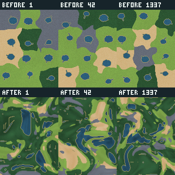

# Geographical world generation overhaul

Implemented for [PR #140](https://github.com/CigThePig/Genetics/pull/140), against main 971e656 including Track 11, Pre-Track 12 and predator-ecology review corrections. The default remains **120 × 160 with 80 founders**. Both 180 × 240 and 240 × 320 remain configurable experimental sizes; rendering memory is substantially improved, but larger-world simulation throughput and ecological density do not earn a default increase.

## Confirmed baseline

The former generator chooses jittered sites, assigns biome labels, and applies nearest-site ownership largely independently of relief and moisture. It stamps a pond and short tributary for each regional site. Canonical full-map inspection confirms repeated rounded water bodies with protrusions and broad flat territories. These are aesthetic/structural shortcomings, not failures of the existing determinism or land-connectivity tests. Baseline tests, resources and ecological operation were preserved for comparison; maps at 30 seeds and canonical ecological endpoints are archived.

Three display-resolution terrain layers scale with tile pixels rather than cells: at 240 × 320 with 20-pixel tiles their combined raw RGBA storage is 368.64 MB. This is a concrete scaling defect. Initialization also shared random consumption across terrain, plants and animals. Founder anchors sampled distant map-wide regions: larger worlds pushed initial nearest prey approximately 86–101 tiles away in the investigated seed, even though local perception and movement remained unchanged.

## Architecture and ecological contracts

Continuous domain-warped multiscale relief and ridged highlands establish broad valleys, elevated rough areas and basin geometry. Lower-frequency temperature/rainfall fields, relief, slope, moisture and medium-scale texture feed terrestrial suitability scores. Existing forest/plains/sand/rock identities remain; prevalence settings bias suitability rather than allocate equal territories or guarantee biome quotas. Terrain region scale now controls coherent field wavelength, with a shorter-dimension cap of 160 tiles so a larger map adds territory without proportionately inflating every feature.

A stable cardinal priority flood computes depression fill/spill levels. Runoff parents descend strictly through raw relief; rainfall accumulates in height order. Lake storage follows basin depth, and channels follow sufficiently accumulated drainage. Shallow headwaters remain traversable riparian shore, which the existing drinking action recognizes. Actual water remains impassable. No lake is assigned per biome, no resource grid is stamped, and no distance threshold inserts emergency ponds. This is lightweight runoff/storage, not hydraulic erosion: some dry catchments terminate internally, river mouths can reach edges, and extremely small maps can lose hydrological diversity.

Shared habitatRgbAt colours combine substrate, environmental fields, local transition tint and vegetation. The renderer samples that same function, quantized to display RGB, preserving the ecological camouflage relationship. Water shade follows storage depth; sparse high-zoom rock/water strokes and existing bushes are cosmetic. The terrain raster is intentionally clean at full-map zoom, with detailed creature shapes above it. Drawing does not mutate simulation state.

One pixel per cell in an opaque offscreen canvas plus its CPU RGBA buffer replaces the old three full-resolution layers. Nearest-neighbor enlargement preserves crisp tiles. Rows update under a 2 ms CPU slice, with 250 ms between completed passes, and dirty rectangles upload changed rows. Immediate paused renders restart and flush a pending pass, including edits to previously painted rows. Reset releases the prior canvas allocation. This simpler architecture avoids a chunk/cache-eviction subsystem while reducing target-size terrain pixel storage to 0.6144 MB including the CPU buffer. Upload/composite costs remain outside the slice budget.

Named deriveSeed RNG streams isolate vegetation, creatures, bushes and runtime using stable FNV-1a labels plus integer avalanche. Terrain explicitly uses generateTerrain({ world, config }): config.seed (default 1) derives distinct geography/climate field seeds, with no RNG argument or unused terrain stream; hydrology needs no random draws. Equal configurations, seeds and tick sequences remain repeatable. Historical trajectories intentionally change. A terrain change can still change accepted spawn suitability, but drawing more terrain random numbers cannot advance a sibling initialization stream.

Positive founder minimum separation now defines a physical local annulus, normally 40–80 tiles, instead of a map-wide distance-maximization search. Suitable-band fallback preserves spawn suitability; zero separation retains unconstrained behavior. Species spread, founder count, movement speed, senses, inheritance, food rules and reproductive rules remain unchanged. This supports nearby ecological cohorts without tracking prey globally or forcing survival. The large 80-founder soak still loses both predators.

## Visual evidence



Top row: former generator; bottom: redesigned. Columns: seeds 1, 42, 1337.

- [Original 30-seed atlas](evidence/visuals/before-atlas.png)
- [Redesigned 30-seed atlas](evidence/visuals/after-atlas.png)
- [240 × 320 30-seed atlas](evidence/visuals/large-atlas.png)

Atlas seeds are 1, 42, 1337, then 2 through 28, in row order. These are deterministic terrain/substrate previews regenerated from the published source after the execution host disconnected, using an adaptive 256-colour PNG palette. The seed-42 regenerated terrain counts were checked against the archived measurement. They preserve actual geography and habitat colours but omit vegetation, creatures, UI and cosmetic browser strokes. They are not the original browser screenshots.

Actual browser inspection before disconnection covered full-world and closer views, touch layout, camera pan/zoom, creature contrast, reset, dimension edits and paused cache updates. During review follow-up the old worktree became accessible again: original browser-before.webp, browser-after.webp, mobile-full-240.webp and mobile-creatures-240.webp, complete trial logs and app/results.json are now archived under evidence/. The previously regenerated PNG atlases remain available alongside the original WebP atlases and environmental-field/trajectory figures. Early prototype inspection exposed straight index-biased flood channels; final flow uses raw downhill relief instead. The final atlases show different basin structures, elongated connected drainage and climate transitions rather than repeated pond stamps. Some small tile transitions and contour marks remain visibly angular; no photorealistic surface is claimed.

## Structural and ecological results

Thirty seeds at both original and target sizes were analyzed: 1, 42, 1337 and 2–28. Automated topology tests independently cover seeds 1–32 and pathological dimensions.

At 120 × 160, the main land component contains 99.919–100% of traversable land across that sample; water covers 2.69–19.69%. At 240 × 320 the ranges are 99.688–100% and 7.68–20.59%. Small islands are allowed rather than deleting all natural separated land.

The maximum seed-level p95 land-path distance to permanent-water adjacency was 40 tiles at original size and 44 at target size. The actual water/shore drinking contract gives per-seed p95 ranges 13–21 and 20–31 tiles respectively. These metrics differ intentionally: wet traversable headwaters can be drinkable without permanent-water adjacency. Suitable founder cells ranged 9,382–13,256 and 36,514–53,040. No coverage quotas or fixed water-body count are imposed.

Fresh 36,000-tick canonical comparisons retain functioning predator reproduction and predation at the original size, with 18/20/29 final kills versus baseline 22/20/16. Dehydration deaths fall to 0/3/2 versus 1/12/11, but RNG/cohort changes confound single-cause attribution. Triangle/octagon endpoint counts include singletons; this is not equilibrium. The large seed-42 80-founder run loses both predators; 128 founders retains 7 triangles and 4 octagons but increases resource mortality. Consequently founder and size defaults are unchanged. No forced reproduction, protected species, detection boosts or population targets were added.

See [measurements.md](measurements.md) for population/death endpoints, performance tables, method, controls and explicit limitations. Raw Node snapshots under evidence include baseline-120, baseline-240, final-120, final-240, baseline-soak, final-soak, large-long-80, large-long-128, stream-control, pre-spawn comparisons, motion summaries, cohort distances and regeneration equivalence. The original 120 stable Node measurement JSON files are supplemented by recovered browser records, completion markers, app results and the original 12 WebP figures; manifest.json verifies 146 original archived files. Historical measurements describe the pre-review implementation, not a fresh benchmark of the review fixes. Thirty seeds times three sizes (90 fresh-grid comparisons) confirmed that clearing reused terrain cells does not alter ordinary fresh generation.

## Performance and default decision

The raster allocation problem is resolved, and first terrain drawing is substantially cheaper. Median desktop first draw at original size/60 TPS fell from 107.1 to 6.1 ms; target size from 389.1 to 13.0 ms. These are measured shared-host software-browser results, not hardware certification.

The final target size sustains approximately 59.8 TPS at 1×, but only 95.9 desktop / 93.0 mobile-layout TPS at nominal 120. Frame tails remain poor under SwiftShader, including at original size. At 180 × 240 throughput is better but frame tails still do not justify a default change. Generation adds priority-flood/climate cost, and per-tick full-grid plant work still scales with area despite the direct-cell terrain lookup optimization. Doubling map dimensions is supported for experiments, not certified as a smooth default.

A 60-second real application check after the paused-cache correction exercised target-size 2× progression, reset, configuration rebuilding, full-map touch zoom and render read-only behavior without page errors. This does not replace hours-long hardware endurance testing. No physical mobile device was available.

## Reproduction and verification

Install locked dependencies with npm ci and run npm run verify. Final local verification and hosted Verify run 39682635929 pass **244 tests**, lint, Prettier and Vite production build. No dependency was added to the application.

The regression suite covers deterministic fields and initialization, independent RNG streams, reused-grid regeneration, terrain identities, drainage strict descent/rainfall accounting, land topology, biome interiors, pathological sizes/aspect ratios, resource/spawn suitability, physical cohort locality, full-map camera fit, pixel allocation, shared colour, reset invalidation and paused dirty-row flushing. Old assigned-region-core assumptions were replaced with per-biome substantial component checks appropriate to environmentally derived terrain. Natural small ponds are allowed rather than forcing a minimum size for every water body.

Examples (output directories may be changed):

```sh
node scripts/verify-world.mjs --width=120 --height=160 --ticks=0 --out=/tmp/world-original
node scripts/verify-world.mjs --width=240 --height=320 --ticks=0 --out=/tmp/world-large
node scripts/verify-world.mjs --seeds=1,42,1337 --ticks=36000 --out=/tmp/world-soak
node scripts/verify-world.mjs --seeds=42 --width=240 --height=320 --population=128 --ticks=36000 --out=/tmp/world-density
node scripts/verify-world-browser.cjs --duration=5000 --trials=3 --out=/tmp/world-browser
node scripts/verify-world-app.cjs
```

The world runner accepts --root for a separate baseline checkout. Preserve the baseline checkout source at 971e656 when comparing. Browser tools require an externally available Playwright/Chromium installation via PLAYWRIGHT_MODULE and BROWSER_EXECUTABLE where needed; they are not production dependencies. Python atlas/trajectory utilities are optional. Browser/temporal reruns regenerate their inputs; the recovered raw browser archives and completion markers now accompany the summary medians.

## Remaining limits

The full target is optional; no claim of 60 FPS on ordinary devices, sustained 120 TPS at target size, universal predator persistence, evolved equilibrium, physically accurate erosion or unlimited canvas/GPU headroom is made. Thirty seeds cannot prove absence of rare poor maps. Diagonal visual channels use cardinal authoritative flow; minimal single-tile headwaters can look angular. Terrain cell/array storage and grass regeneration remain area-dependent. Very small worlds degrade in diversity rather than receiving forced resources. Longer ecology and actual device profiling are the next evidence needed before any default enlargement.

The host became unavailable during initial publication, then recovered during review follow-up. The original measurement archives, browser screenshots and aggregation/browser-runner updates are now committed and verified against their original manifest. Raw motion gzip recordings and PPM map inputs remain optional uncommitted reproducible inputs; the plotter now reports their absence and still produces population figures. See [review.md](review.md) for all six Codex review fixes, source provenance and separate verification. The PR is submitted for review; nothing was merged or deployed.

Review follow-up: **256 tests** now cover the fixes; original 244/252-test results above are historical. Review validation and recovered artifact links are in [review.md](review.md).
