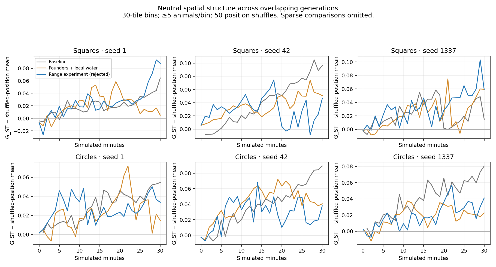
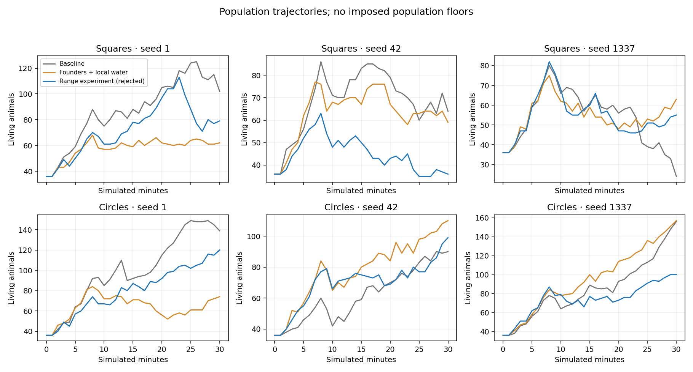

# Spatial ecology investigation

## Outcome

The simulation already develops neutral spatial family structure. Fast travel does not automatically erase it, and neither larger maps nor added range preferences demonstrated a consistent improvement in geographic genetic differentiation in this study. **Sustained habitat adaptation remains unproved.**

The production changes are deliberately small: viable separate founder communities, a repaired personal-versus-shared water choice, passive pedigree/neutral inheritance, and reusable spatial/genetic measurements. Two different residency implementations were tested and removed. No regional genomes, mating prohibitions, population floors, migration quotas or territory forces are introduced.

## Evidence and diagnosis

Baseline is main **5740523**, including PRs #138–#140. Passive instrumentation is archived at **6c5027d**. Ten distinct seeds are 1, 2, 3, 7, 19, 42, 73, 101, 1337, 2026. The study contains **61 completed ecological runs / 2,844,000 ticks / 790 simulated minutes**, including nine 108,000-tick runs. Controlled short ablations and size/density trials are separate from the matched long comparisons. All configurations, deterministic outcome fingerprints and source provenance are in [the manifest](evidence/manifest.json).

At the canonical 36,000-tick baseline, square median maximum natal displacement is 82/71/91 tiles; circle values are 67/79/93. Median travel before first conception is 272/190/231 tiles for squares and 182/261/280 for circles. First conception occurs at median ages approximately 120–136 seconds for herbivores. Successful partners are physically nearby, but 95th-percentile natal mating distances are 75–123 tiles across the two herbivores/canonical seeds. Thus much mixing comes from prior movement and successive local breeding, rather than remote reproduction.

Path length and home range are different: animals can travel hundreds of tiles through local excursions while their net displacement remains much smaller. The seven broad baseline seeds attribute **47.6% of square and 46.9% of circle path length to herd-water seeking**, versus 15.3%/16.4% to wandering. An early short trace suggested the same cause; final tables use the full recorded broad runs. Arbitrarily slowing idle wandering would therefore leave much travel intact.

The water arbitration has a reproduced defect: a thirsty group member with a distant shared destination can bypass substantially nearer personally observed water, retaining an older rendezvous commitment. The repair treats social information as an additional option. Personal observations/positive water memories can supersede a shared target when at least 15% nearer. Existing distance conventions, resource-search fallback and navigation remain; this is not an optimal route-cost planner. No extra resources are created.

Functional traits retain the existing blended inheritance/noise/mutation model. Neutral diagnostic loci use independent diploid segregation instead, which avoids interpreting blended colour variance as a direct population-genetics estimator. Neutral loci never affect phenotype or decisions.

## Selected changes

`creatureFounderGroups` defaults to two. Additional communities select separated suitable connected vegetated land with water access from bounded candidates. At least twelve founders are required per requested species/community; this is a conservative initialization policy, **not a proven minimum viable population**. The default herbivores form two groups of eighteen, each with nine males and nine females. Four triangles and four octagons remain together by species. Counts, founder ages, speed, maturity and world size are unchanged. Small or unsuitable maps may not yield meaningful separation.

Extra placement streams preserve every founder's original genome and do not advance runtime RNG. Paired seeds therefore begin with matched founding phenotypes, although later changed decisions naturally diverge RNG trajectories. Founder community IDs are initial bookkeeping only; offspring receive no permanent population label.

Each creature stores copied birthplace, parent IDs/birthplaces and sixteen unlinked diploid biallelic neutral loci. Paternal diagnostic data are captured at conception and survive paternal death. Histories and genealogy graphs live only in offline tools; gameplay state is constant per creature. The inspector exposes birthplace and natal displacement. Rendering remains read-only.

In the seven paired 600-second broad seeds, mean seed-level median first-conception displacement falls **26.8→22.8 tiles for squares and 27.2→22.9 for circles**. Maximum natal displacement improves for squares but increases for circles. Endpoint excess neutral G_ST does not consistently improve. These are useful changes in initial breeding geography, not proof of increased divergence.

At 1,800 seconds, baseline loses all six canonical predator populations. The selected changes retain reproducing octagon lineages in seeds 1 and 42, reaching pedigree depth eight; triangles still disappear in every long run, and both predators disappear in seed 1337. Both herbivores persist in all compared runs. Three seeds do not establish improved equilibrium or universal viability. Additional age deaths in a more reproductive run are not themselves a higher mortality rate.

## Rejected mechanisms and limitations

A six-site memory of successful feeding biased discretionary destinations but failed to consistently reduce displacement. A second candidate required successful food **and** water acquisition before learning a persistent range, with a flat interior preference, fading confidence, relocation and release after distant displacement. Survival, mating, social regrouping and pursuit retained authority. It also failed to improve the broad outcomes consistently: square mean median maximum displacement was 74.6 tiles versus baseline 71.4 and selected production 61.8; circle values were 70.3 versus 63.9/70.8. Stronger individual results occurred, but long-run differentiation/viability tradeoffs were mixed. A near-zero-penalty directional-choice control and the complete negative results are archived. **Both candidate implementations and their config/UI fields were removed from production**, rather than retained as dormant features.

Two initial communities still exchange ancestry. At 30 minutes some runs have completely mixed pedigrees, while seed 42 retains unmixed descendants. Mixed genealogy does not prove homogenized allele frequencies; a small immigrant contribution can spread through many pedigrees. Conversely, positive neutral G_ST can reflect founder sampling, family groups and drift rather than local selection. The measured baseline already exhibits substantial structure, sometimes stronger than either candidate. No statistically established general divergence improvement or habitat-specific adaptation is claimed.

Environmental selection already acts through substrate camouflage, perception, movement friction and plant availability. This study does not supply a causal fitness experiment demonstrating adaptation to forest versus plains. Adding prescribed habitat genomes or harsher biome penalties was unjustified. Phenotypic blending, limited reproductive sampling, predator loss and longer-term environmental selection remain research questions.

## Map scale, performance and behavior

Seed-42 180×240 and 240×320 trials, with 80 founders and a separate 128/16 density case, retain reproduction but do not establish a divergence advantage. The density case also changes predator proportion. Default dimensions remain **120×160**; larger configurable worlds remain available. See [measurements](measurements.md) for all endpoints and exact scope.

Three alternating-order Node trials use the original main and revised implementation, 2,400 warmup + 1,200 measured ticks per trial. The initial performance archive includes the rejected candidate; a separate production-only rerun is retained. All measured cohorts finish at eighty animals. Timing differences are small/noisy and are not treated as a speedup. Initial JSON snapshots add about 16 KB for passive state; this is not a heap allocation estimate. GC deltas included negative values and are not used to claim reduced memory. Runtime does not retain detailed spatial histories.

Real Chromium checks exercise desktop and 390×844 touch layout, normal/2× progression, camera views, paused rendering, inspector and temporal observation. They report zero page errors and unchanged simulation state after rendering. The 12-second paired software-browser windows sustain about **59.8–59.9 TPS / 119.7–119.8 TPS**, but only roughly **6–17 FPS** in both control and revised modes. These poor SwiftShader/shared-host frame times do not certify 60 FPS or physical-phone behavior. No frame-rate improvement is claimed. New production movement changes only resource destination choice; heading, acceleration, pursuit and fleeing engines are retained.

[Desktop inspector](evidence/browser/default/desktop-inspector.webp) · [Touch inspector](evidence/browser/default/mobile-inspector.webp) · [Temporal world observation](evidence/browser/default/movement-3.webp)

## Verification and replay

- `npm run verify`: 272 tests, lint, formatting and production build pass.
- `npm run test:soak -- --ticks=36000`: canonical seeds pass every-tick finite/bounds/ID/population-accounting checks; endpoints match the corresponding long-run checkpoints.
- Three 3,600-tick canonical comparisons hash normalized state identically to the immutable experimental snapshot with its rejected features disabled. World function identities are excluded and Map contents are serialized; the initial direct object-reference comparison was unsuitable for independently constructed worlds.
- A separate 600-tick favorable breeding control produces a birth and exactly matches original main after removing passive fields, demonstrating diagnostic RNG independence through reproduction.
- Regression coverage includes neutral segregation, paternal-death pregnancy, copied state/reset, sample-size/monomorphism guards, founder genome preservation/sex pairs/tiny/extreme maps, personal-water commitment priority and pedigree analysis.

[Tooling and archive format](tooling.md) explains original-observer limitations, units, censoring, genotype retention, sampling/permutation interpretation and exact-source replay through the small incremental Git bundle. Archives preserve measured observations; deterministic outcomes are not hard-coded tests for a desired amount of divergence.
