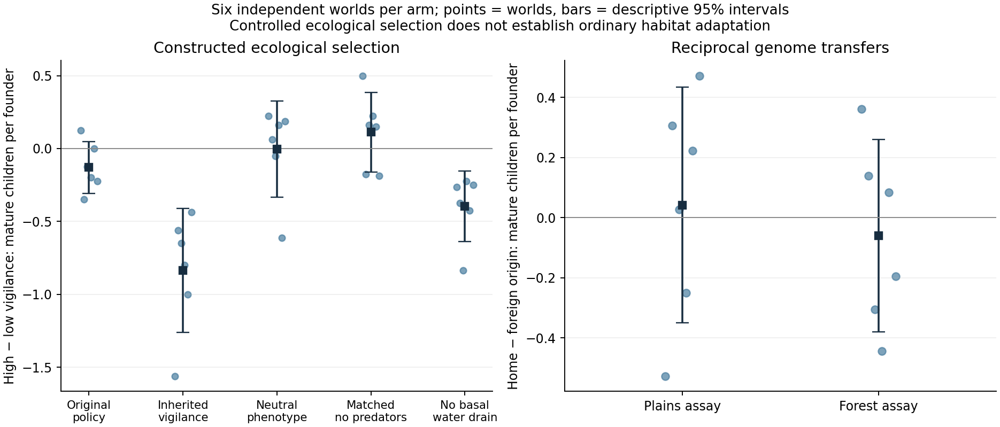
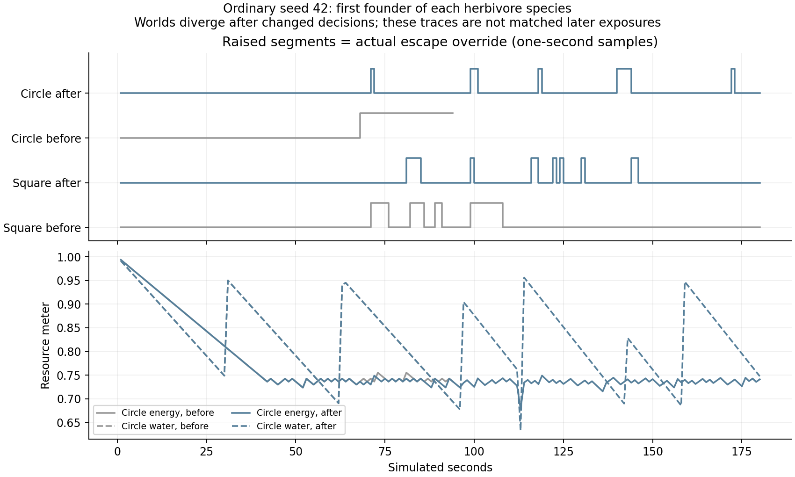

# PR #144 continuation: ecological selection and inherited vigilance

## Executive assessment

The original PR correctly improved inheritance without proving ordinary habitat adaptation. This continuation preserves that work and fixes all three review findings. Its production change gives the existing alertness locus a consequential, local behavioral choice: how close an observed danger can approach before escape interrupts feeding and drinking. It resolves competing movement/pacing authority rather than adding personalities, planning, genes or demographic protection.

Full-engine experiments demonstrate ecological selection on that inherited choice, including a counterintuitive result: cautious founders suffer fewer predator deaths yet raise fewer mature children in a resource-constrained arena. Neutralizing vigilance largely removes that reproductive contrast. Reciprocal habitat transfers do **not** establish local adaptation, despite forest populations tending toward slower inherited speed. Ordinary-world changes remain variable across seeds. This is a stronger causal evolutionary opportunity and a more interpretable behavior, not proof that the experiential problem is solved.

## Scope, provenance and method

The original PR head was `470bbc33ca44a9f0b5864bb6abfff2bd25845dcb`. Review repairs were published as `ac3e8af10aef593762343f45073dbc225d34a8b3`, with the same tree as local experimental baseline `992c84122dc4eb6697f02c48bdd2dd3ac24f0b28`. The behavioral candidate is `5f9ea2cf2e47cc0667561de6206129082b05d1ae`. Final observability/lifecycle cleanup was measured separately against that frozen candidate; a 9,000-tick ordinary replay including 24 births has identical actor states.

The [source bundle](evidence/continuation/source.bundle) preserves experimental commits independently of GitHub publication metadata. Every new ecological record contains the exact source commit, clean-source flag, SHA-256 fingerprint of **all** `src/` bytes, complete configuration, Node/platform, seed, TPS, ticks, simulated seconds, life records and end-state hash. The analysis recomputes fingerprints from immutable Git objects, checks registered treatment/configuration, transfers' source-file hashes, duration/history consistency, and archived runner hashes. [Protocol defaults](evidence/continuation/protocol-config.json) are pinned independently of future production defaults. The original evidence and its provenance exception remain unchanged.

All seeds are predefined: 1, 42, 1337, 2, 7, 19. Statistics aggregate the two herbivore species **within** each world before comparing six independent seeds. The descriptive 95% intervals use a t multiplier for six worlds; they are small-sample uncertainty summaries, not a multiple-testing-adjusted declaration of adaptation.

| Program                                  | Worlds | Conditions                                                                                                                                  |
| ---------------------------------------- | -----: | ------------------------------------------------------------------------------------------------------------------------------------------- |
| Ordinary candidate                       |      6 | Default 120 × 160 world, 80 founders / 8 predators, 60 TPS, 72,000 ticks / 1,200 s; compare all six original segregating runs               |
| Extended ordinary                        |      1 | Seed 1337, same defaults, 108,000 ticks / 1,800 s; compare original extended segregating run                                                |
| Habitat × inheritance                    |     24 | 48 × 24, 40 founders / 4 predators, forest/plains land × blended/segregating, 30 TPS, 36,000 ticks / 1,200 s                                |
| Common environment / reciprocal transfer |     24 | Two donor origins × two assay habitats × six seeds, 36 herbivores, 30 TPS, 1,200 s                                                          |
| Vigilance ecological selection           |     36 | Six seeds × baseline/candidate/neutralized vigilance/water-drain ablation/matched predator removal/exploratory predator-free initialization |

Total: **91 new life-history records, 3,564,000 ticks, 30.5 hours of simulated ecological time**. Constructed habitats are not ordinary gameplay. Their terrain/resources are initialized once; subsequent perception, memory, decisions, navigation, feeding, costs, predation, mating, gestation, inheritance, mutation and death use production ticks. There are no external reproductive weights, population floors, forced births or replenishment.

The channel habitats put water at `x % 16 == 0`, initially fill grass to actual terrain capacity, remove bushes, and match founders across terrain/inheritance arms. They fragment land into three breeding strips, making drift and mating opportunities important. Transfers copy living descendant **genomes**, sample uniformly with replacement by species using an independent assay seed (`source seed + 100000`), and reset age, reserves, memory, pedigree and neutral markers. Donor genotypes/assay positions are identical across destination habitats; this tests inherited differences without learned environmental carryover. Predators are deliberately absent from both transfer destinations, so this is a foraging/demographic assay, not a test of inherited predator adaptation. Small donor pools are retained and reported rather than silently replaced.

The vigilance arena instead has connected land and a water edge at `x == 0`. Founder alertness is shuffled between .1 and .9, as balanced as group size permits within sex/species. These broad alternatives are an explicit diagnostic intervention, **not** ordinary founder variation. Other genes retain seeded variation. Four-predator worlds have only one founder per predator sex/species, so those singleton groups receive the first alternative; within-world herbivore contrasts share those predators. The neutral arm maps alertness to a constant phenotype. The water ablation sets only basal water drain to zero and retains reproductive water costs.

An initial predator-free configuration also changed founder genotypes/positions. Those six runs remain in the evidence as **exploratory** and are not used as the matched causal ablation. Six corrected runs initialize the same world and then remove predators before the first tick, retaining herbivore IDs/genomes/sex/placement/age/reserves, runtime seed and next-ID counter. Trajectories may subsequently diverge through legitimate stochastic interactions.

## Diagnosis and production decision

Existing resource searches respect perception and memory; the hypothesis of omniscient foraging was rejected. Original wild founder speed/perception associations with mature-child success were weak and inconsistent. More complex planning was therefore not justified.

The concrete behavioral limitation was overlapping authority. Herding treated every acquired threat as an escape movement override, while a separate state machine paused to assess or declared relaxation using another threshold. Feeding/drinking still executed during escape, and inspection could call the animal “eating.” Existing alertness variation mostly affected a quantized reaction delay and tiny pause differences.

A 54-case controlled stationary-predator fixture (six seeds × three inherited alertness values × three distances) shows the old escape-time difference was only hundredths of a second, while all groups fed during escape. The candidate creates distinct choices at the same observed distance and an actual resource opportunity cost. It proves a decision mechanism, not hunting success or adaptation.

The accepted production changes are:

- Alertness multiplier range .2–1.8 instead of .85–1.15. Neutral genotype retains the configured baseline phenotype. This is broader expression of an existing locus, with existing mutation/inheritance and no habitat-directed assignment.
- Individual escape buffer = configured distance × clamped inherited alertness / baseline alertness, with a two-tile emergency floor. Detection still requires actual visibility or a bounded local warning. No distant predator knowledge is introduced.
- Escape exit at 1.25 × acquisition buffer, plus existing direction commitment, prevents acquisition-boundary oscillation.
- Herding owns the escape decision; production behavior integration immediately enters flight, and relaxed pacing cannot insert another assessment stop. Feeding/drinking are interrupted during escape. Births and ecological failures remain unprotected.
- Inspector shows the buffer and actual escape activity. Vigilance joins the existing bounded inherited-history selector, with a truthful tradeoff explanation and no adaptation/discovery label.
- Inheritance changes remain pending until a world rebuild, protecting the active world's treatment through both immediate and gestating birth paths. No selector change silently destroys progress.

The standalone legacy state helper retains compatibility for direct callers; normal production escape decisions pass through herding/integration. No new global actor search, planner, per-tick event log or unbounded history is added.

## Quantitative results

The final audited analysis and figures below contain the complete seed matrix, including extinction, censored careers and failed adaptation tests. Fitness means refer to children reaching reproductive maturity; they do not equate predator avoidance or census growth with evolutionary success.

### Ordinary ecosystems: all six seeds

| Seed | Prey square/circle, before → after | Predators triangle/octagon, before → after | Kills, before → after | Mature herbivore offspring, before → after | Mean living prey pedigree depth, after |
| ---- | ---------------------------------- | ------------------------------------------ | --------------------- | ------------------------------------------ | -------------------------------------- |
| 1    | 107/90 → 99/119                    | 0/0 → 4/4                                  | 15 → 71               | 319 → 371                                  | 5.14                                   |
| 42   | 106/129 → 68/142                   | 3/5 → 0/15                                 | 43 → 74               | 393 → 341                                  | 5.13                                   |
| 1337 | 111/69 → 150/144                   | 10/24 → 0/7                                | 69 → 53               | 363 → 443                                  | 5.19                                   |
| 2    | 160/114 → 164/163                  | 4/3 → 2/0                                  | 38 → 47               | 435 → 450                                  | 5.50                                   |
| 7    | 103/128 → 114/54                   | 5/3 → 4/5                                  | 42 → 70               | 356 → 320                                  | 4.70                                   |
| 19   | 60/118 → 99/88                     | 3/5 → 4/1                                  | 42 → 74               | 358 → 318                                  | 5.29                                   |

All founder careers are completed at the main horizon. Mature means reaching the configured effective-age reproductive threshold; it is not the visual adult-stage label. Living descendants and their future reproductive outcomes remain right-censored. Pedigree depth is ancestry depth, **not** synchronized population turnover. Births, maturation and reproducing descendants are reported by depth in the detailed archive.

Ordinary-world founder vigilance selection differential averages +0.0018 gene units across worlds (descriptive interval -0.0029 to +0.0066); the matched mature-child response averages +0.0013. This is weak evidence with substantial variability, not a causal wild-adaptation result. Neutral marker selection summaries and parent-to-offspring transmission/mate terms are retained in the detailed analysis rather than presented as adaptation scores.

At 1,800 seconds, ordinary seed 1337 ends at square/circle/triangle/octagon 113/60/11/39 → 181/154/0/2. This single-world extension is not a replication of sustained adaptation; its source and complete histories are archived.

### Controlled ecological selection and failed local-adaptation claim

| Contrast                                                       |   Mean | Descriptive 95% interval across six worlds |
| -------------------------------------------------------------- | -----: | ------------------------------------------ |
| Candidate: high − low vigilance, mature children/founder       | -0.835 | -1.262 to -0.409                           |
| Candidate: high − low vigilance, predator-death fraction       | -0.438 | -0.552 to -0.323                           |
| Original policy: high − low vigilance, mature children/founder | -0.129 | -0.307 to +0.049                           |
| Neutralized phenotype: high − low, mature children/founder     | -0.004 | -0.334 to +0.326                           |
| Matched predator removal: high − low, mature children/founder  | +0.112 | -0.161 to +0.386                           |
| No basal water drain: high − low, mature children/founder      | -0.396 | -0.637 to -0.154                           |
| Plains assay: home − foreign origin, mature children/founder   | +0.042 | -0.350 to +0.434                           |
| Forest assay: home − foreign origin, mature children/founder   | -0.060 | -0.380 to +0.259                           |
| Plains: segregation − blending, mature offspring/species       | +5.333 | -14.000 to +24.666                         |
| Forest: segregation − blending, mature offspring/species       | +4.917 | -10.161 to +19.994                         |

The vigilance reproductive disadvantage has the same direction in all six candidate worlds, despite fewer predator deaths. Both the matched predator removal and constant-phenotype controls weaken the association. This establishes a consequential inherited ecological tradeoff under the constructed 30-TPS conditions, not universal strategy superiority or ordinary adaptation. The 60-TPS stationary-threat fixture independently checks the decision/resource mechanism; default-TPS fitness magnitudes are not assumed identical.

Both reciprocal intervals span zero, and neither pair establishes a home advantage. The forest speed tendency therefore remains genetic change rather than validated local adaptation. Segregation raises endpoint speed variance more consistently in forest, but neither habitat shows a reliable mature-offspring improvement. Variance is evolutionary opportunity, not proof of adaptation.





Detailed, audited output: [summary](evidence/continuation/analysis.json), [per-run/fitness/cohort/neutral details](evidence/continuation/analysis-runs.json.gz), [source/environment](evidence/continuation/sources.json).

## Behavioral observation and experience

[Before](evidence/continuation/browser-before/segregating-180.jpg) and [after](evidence/continuation/browser-after/segregating-180.jpg) are actual seeded production-browser views, not constructed arenas. The normal seed-42 browser runs observed 0, 60 and 180 seconds, following the first founder of each species and recording one-second traces. These are fixed-ID samples from a predefined normal seed, not a selected “best strategy.” There were 47 versus 21 escape samples among the watched animals; this is a behavioral trace comparison, not a population statistic or proof of superior intelligence.

The watched circle originally entered prolonged escape while its intent alternated among search, wander and mate. The candidate's same founder has an 8.2-tile buffer, briefly escapes at 71 seconds, then returns to resource/mate decisions. The watched square has a 7.5-tile buffer and continues normal activity through that encounter. The worlds then diverge, so later positions cannot be treated as identical ecological exposures. Some reactive foraging switching remains. The inspector exposes the actual escape action and inherited buffer, and history can compare the vigilance distribution.

The browser audit compared each observed world with a fresh direct simulation in the same Chromium runtime at 10,800 ticks: actor arrays matched exactly (107 baseline actors; 99 candidate actors). Node and Chromium trajectories differed despite matching seed/configuration; cross-runtime bit-identical replay is therefore not established. Browser event times must not be substituted for headless event times. The watched-founder traces have unequal exposure and are not a fitness comparison.

This makes a real strategy difference inspectable, but subjective compellingness has not been independently established. Screenshots alone do not prove coherent behavior; replayable traces and the controlled opportunity-cost assay support the narrower claim. No generated imagery, staged “adaptation” screenshot or fabricated discovery narrative is used.

## Rejected or deferred explanations and candidates

- **Forest speed divergence implies adaptation:** rejected by the reciprocal assay's lack of reliable home advantage. Genetic drift, founder effects, resource/mating differences and finite donor pools remain alternatives. The transfer removes predators, so predator-specific adaptations are not excluded.
- **More variance guarantees richer evolution:** rejected. Segregation preserves alternatives, but full-engine habitat performance remains variable. The original blended system was capable of genetic/reproductive response.
- **High vigilance is universally better:** rejected. It reduces predation in the arena while costing mature offspring; extinction remains possible. The candidate does not optimize every organism toward survival.
- **Thirst alone explains the reproductive contrast:** not established. Removing basal water drain weakens but does not eliminate the high-vigilance reproductive disadvantage; energy opportunity, encounter geometry, mating and other interactions remain.
- **A predator-free initialization is a clean predator ablation:** rejected and corrected with matched removal; exploratory runs are preserved.
- **Increase predator density/fertility or protect lineages:** not implemented. Small effective breeding populations and sex loss remain real limitations; higher census is not evidence of adaptive success.
- **Rewrite mutation immediately:** deferred. Original neutral controls already showed upward cost-locus drift under positive-only pleiotropy; new parent-to-mature-child accounting separates reproductive weighting from transmission/mate contribution, but does not identify mutation as the sole cause of wild drift. Mutation, noise and pleiotropy remain unchanged to isolate this intervention. A signed-cost or pleiotropy removal redesign needs its own long-horizon paired ecological tests.
- **Add personalities, intelligence framework or an analytics dashboard:** rejected as unnecessary for the demonstrated decision/fitness connection.

## Validation, performance and remaining gap

`npm run verify` passed **318 JavaScript tests**, lint, formatting and build; **20 Python tests** passed. Targeted birth-path and warning/hysteresis regressions passed after the final derived-state cleanup. Final source-preserving replay includes 24 births. Browser checks passed at desktop and 390-pixel width, including vigilance selection, pending inheritance changes, explicit world rebuild/history reset and read-only rendering.

| Equal actor workload | Original median trial mean (ms/tick) | Final median trial mean (ms/tick) |
| -------------------: | -----------------------------------: | --------------------------------: |
|                   80 |                                2.355 |                             2.286 |
|                  240 |                                6.705 |                             6.918 |
|                  480 |                               19.775 |                            21.757 |

Three alternating trials use 120 warm-up plus 600 measured ticks, before births and with equal actor counts. Actor hashes intentionally differ because behavior changes. Default-size results are similar; 480 actors cost about 10% more in the uninstrumented median comparison, and **both revisions exceed 16.7 ms/tick**. No speedup or high-density real-time guarantee is claimed. Instrumented profiles identify the existing herding/neighborhood work as the dominant 480-actor cost; that does not isolate all of the observed timing difference.

Adding the seventh inherited distribution increases a full 120-snapshot serialized history from 629,401 to 686,281 bytes in the fixed-founder structural fixture. This is a bounded JSON-size comparison, not physical heap measurement. Actor state gains a derived scalar buffer; no new unbounded retention or global actor scan is introduced. [Alternating profiles](evidence/continuation/performance.jsonl), [instrumented profile](evidence/continuation/hot-paths.json), [earlier supplementary profile](evidence/continuation/hot-paths-initial.json), [observability replay](evidence/continuation/observability-replay.json).

Deterministic replay, world independence, reset/history lifecycle, explicit rebuild, both birth paths, non-default-TPS recording, source/config/transfer verification and causal vigilance regressions are covered. Rendering remains observational. Desktop and 390-pixel browser checks exercise the history selector and actual inheritance pending/rebuild flow. No physical-phone performance certification is claimed.

Lifetime lineage fitness and regional causal comparisons still require offline research tooling; the new live view reveals vigilance and its immediate cost, not an evolutionary narrative.

The central remaining gap is **sustained, causally demonstrated adaptation in ordinary ecosystems**, including reciprocal advantages under their actual predator/resource context. The next defensible investigation should follow a specific ordinary-world selection signal, preserve migration/mating context, test descendants against founder/foreign populations, and ablate that pressure. Longer bottlenecked predator lineages and mutation-cost accumulation need replication beyond a single extended world. The creator remains the judge of whether the resulting ecosystem is worth watching.

## Reproduce and audit

```sh
npm ci
npm run verify
# Full history (including 470bbc33) is required for the incremental bundle.
git fetch --unshallow # only for a shallow checkout

git fetch tracks/2026-10-23-emergent-evolution/evidence/continuation/source.bundle \
  refs/heads/evidence/pr144-continuation:refs/evidence/pr144-continuation
python -m unittest discover -s tests -p 'test_*.py'
python scripts/analyze-natural-evolution.py tracks/2026-10-23-emergent-evolution/evidence/continuation
python scripts/plot-natural-evolution.py tracks/2026-10-23-emergent-evolution/evidence/continuation
```

Create immutable worktrees at the declared commits; never rerun a baseline using modified production files. Use fresh output paths (recorders refuse overwrite):

```sh
node scripts/investigate-evolution.mjs --root=/path/to/frozen-candidate --seed=42 --ticks=72000 --out=/tmp/wild-42.json.gz
node scripts/natural-evolution.mjs --root=/path/to/frozen-baseline --seed=42 --habitat=forest --seconds=1200 --out=/tmp/forest-42.json.gz
node scripts/natural-evolution.mjs --root=/path/to/frozen-baseline --seed=100042 --habitat=plains --transfer=/tmp/forest-42.json.gz --config='{"creatureCount":36,"creaturePredatorCount":0}' --out=/tmp/transfer.json.gz
node scripts/natural-evolution.mjs --root=/path/to/frozen-candidate --seed=42 --water=edge --polymorphism=alertness --remove-predators=1 --out=/tmp/matched-no-predators.json.gz
```

The archived runner and source hashes distinguish tool revisions. `--partial` analysis is explicitly exploratory; final evidence requires the complete registered matrix. See [tooling](tooling.md) for browser and performance commands. The continuation has its own artifact manifest; the original report and manifest remain historical snapshots.
