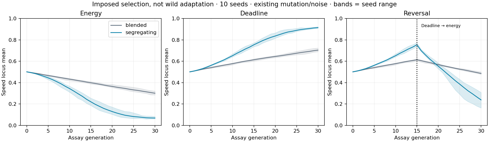
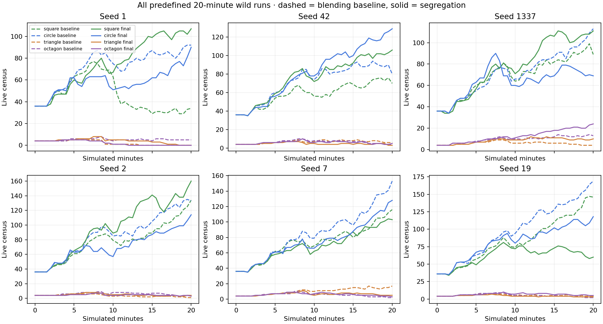
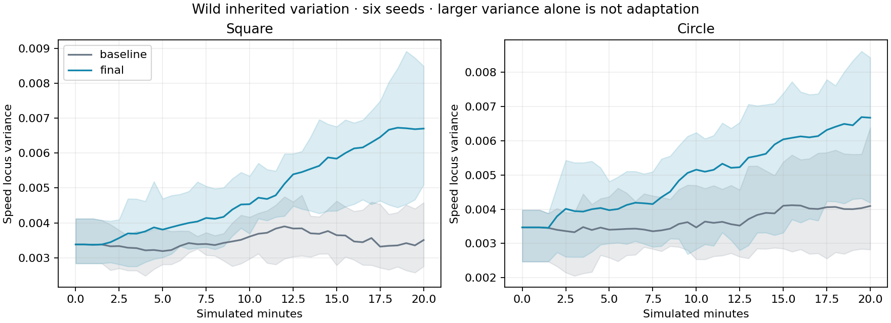

# Evolutionary scope, selection and observability

## Result and limits

Genetics already has a functioning genotype → phenotype → ecological cost/opportunity → reproduction pathway. It is not merely generating decorative genes. The investigation identifies a specific constraint: blending every parental locus repeatedly dilutes inherited alternatives, leaving sustained response disproportionately dependent on continual mutation/noise. That does **not** mean current defaults lose all variation: the neutral controls directly disprove that stronger claim.

The selected changes preserve parental alternatives through simple per-locus segregation and reveal six inherited distributions in the existing history view. They do not introduce more species, a planner, adaptive habitat assignments, a hidden fitness function, population correction or new survival buffs. Functional genomes stay flat and the existing tradeoffs remain active.

Controlled experiments establish stronger hereditary response and a real reversal of reproductive advantage under different constraints. Wild runs establish continued reproduction, changed inherited distributions and different ecological histories. **They do not establish sustained local habitat adaptation, better predator persistence or that the entire experiential “soul” problem is solved.** The actual browser observations show largely familiar need-driven behavior before turnover; no new decision policy or intelligence claim is made.

[Diagnosis and rejected candidates](diagnosis.md) · [Exact reproduction instructions](tooling.md) · [Machine-readable comparison](evidence/summary.json) · [Source and artifact checksums](evidence/manifest.json)

## Provenance and experimental design

Baseline is main `b0985754ef70fd4bc6517bafa16e522bbb134000`, after PR #143. The production candidate is local experimental commit `da9764494cb015f8257dcc4c7d326b02224de2cc`, preserved in the incremental [source bundle](evidence/source.bundle). The bundle has baseline main as its prerequisite. The full source fingerprints, clean authoritative-source status and file lists are in [provenance.json](evidence/provenance.json); publication metadata can have different commit IDs without changing these source bytes.

The predefined wild sample is seeds **1, 42, 1337, 2, 7, 19**, both sources, 72,000 ticks each: twenty simulated minutes at 60 Hz. A separately predefined seed-1337 pair extends to 108,000 ticks: thirty minutes. Fourteen field recordings total 1,080,000 ticks / 300 simulated minutes. Each includes complete resolved configuration, source commit, environment, tick duration, copied lifetime genomes/parents, reproductive maturation/death, one-second activity samples, 30-second distributions and a final actor hash. Founders match exactly between arms. No failed seed is removed. Runtime cost during concurrent recording is **not** used as performance evidence.

All runs retain default 120 × 160 terrain, 80 founders (36/36 herbivores and four/four predators), sex balance, resources, life history, pregnancy and behavioral rules. Source changes consume different numbers of inheritance RNG draws, so later worlds are replicated comparisons, not paired identical ecological events. Generation figures are pedigree depth, not synchronized population turnover. Mature offspring counts and complete founding careers are reported separately; surviving immature/adult careers are censored.

## Isolating inheritance and selection

For independent parents, the existing uniform random blend retains two-thirds of scalar variance per generation; midpoint inheritance retains one-half. The former follows from E[(1−t)²+t²] = 2/3 for uniform t. These are null-model expectations, not assumptions about assortative wild mating. With default ±.03 inheritance noise and per-locus .2 probability of ±.12 mutation, the interior scalar null equilibrium is approximately (.03²/3 + .2×.12²/3)/(1−2/3) = **.00378** variance. Thus mutation/noise can keep the live population variable while averaging still erases specific selected alternatives.

The controlled suite uses production genome/trait functions, 1,000 organisms, thirty non-overlapping generations, ten predefined seeds and exactly matched founders. Neutral, energy, deadline and reversed-pressure arms compare both inheritance modes, with mutation/noise on or off. Reproductive weights are explicitly imposed in this offline assay: they never enter the simulation. A 30-tile traversal has .03 available energy in one treatment or a 3.5-second deadline in another. The reversal changes deadline to energy halfway through. The former weak-pressure assay (energy 1, deadline 20 seconds) remains archived as a weak/negative result, not discarded because it lacked spectacle.

There are **160 main assays plus 160 weak-pressure assays**, totaling 9.6 million generated offspring. These are genetic response experiments, not 320 wild ecosystems or habitat-adaptation trials. The table reports seed means; raw histories and per-treatment seed ranges are retained.

| Mutation / noise | Pressure | Blended mean | Segregating mean | Blended variance | Segregating variance |
| ---------------- | -------- | -----------: | ---------------: | ---------------: | -------------------: |
| Off              | neutral  |       0.5014 |           0.5049 |        1.715e-08 |             0.003172 |
| Off              | energy   |       0.4815 |           0.4199 |        1.513e-08 |            0.0003649 |
| Off              | deadline |       0.5218 |           0.5824 |        1.169e-08 |            0.0002809 |
| Off              | reversal |       0.5218 |           0.5281 |        1.277e-08 |             0.001962 |
| On               | neutral  |       0.4984 |           0.4944 |         0.003775 |               0.0427 |
| On               | energy   |       0.3011 |           0.0690 |         0.003717 |             0.005302 |
| On               | deadline |       0.7041 |           0.9146 |         0.003715 |             0.006893 |
| On               | reversal |       0.4862 |           0.2388 |         0.003801 |              0.02023 |

Bands span the ten seed means; they are ranges, not confidence intervals. With mutation off, segregation preserves the pre-existing alternatives and selection can continue, whereas blending approaches a narrow distribution and stalls. With mutation on, both models respond, so claiming that the original simulator cannot evolve would be false. Segregation enables a larger response and reversal under these conditions. Its neutral variance also grows substantially with the existing mutation settings: **that growth is not adaptation**, and finite-population drift can still lose alternatives.

Neutral basal-energy loci drift upward on average from approximately .500 to .548 under blending and .544 under segregation. The existing positive-mutation pleiotropy rule contributes a directional cost input; a metabolic trend alone must not be called selection. The same rule is retained in both arms rather than changing inheritance and metabolic costs simultaneously.

## Does phenotype actually alter reproductive success?

The **96 constructed engine fixtures** use actual trait creation, metabolism or physical movement, reproductive eligibility, conception, pregnancy, birth and inheritance. They fix maturity, guarantee conception only within the fixture, use one-tick gestation and disable mutation to isolate the mechanism. They do not replenish or intervene in normal worlds.

| Constructed opportunity                                         | Slow speed locus .1 | Fast speed locus .9 | Causal ablation                      |
| --------------------------------------------------------------- | ------------------- | ------------------- | ------------------------------------ |
| .78 energy; eight-second recovery with no food                  | 12/12 births        | 0/12 births         | Remove speed→energy cost: both 12/12 |
| Mate twenty tiles away; opportunity evaluated after 3.5 seconds | 0/12 births         | 12/12 births        | Neutralize speed mapping: both 12/12 |

The twelve cases per cell are four species across three shared seeds, **not independent wild population replicates**. The travel fixture isolates movement without a food economy; the reserve fixture isolates metabolism without travel. Offspring retain the successful parents' speed values with mutation off. This demonstrates an existing functional tradeoff and the complete local inheritance pathway, not normal ecological adaptation or a new authored survival strategy.

[Fixture definitions and results](evidence/mechanisms.json)

## Wild outcomes and turnover

Twenty-minute live census, baseline → segregation.

| Seed |   Squares |   Circles | Triangles | Octagons |
| ---- | --------: | --------: | --------: | -------: |
| 1    |  34 → 107 |   92 → 90 |     0 → 0 |    5 → 0 |
| 42   |  70 → 106 |  80 → 129 |     6 → 3 |    4 → 5 |
| 1337 |  89 → 111 |  113 → 69 |    4 → 10 |  13 → 24 |
| 2    | 134 → 160 | 133 → 114 |     1 → 4 |    4 → 3 |
| 7    | 116 → 103 | 153 → 128 |    17 → 5 |    2 → 3 |
| 19   |  146 → 60 | 169 → 118 |     4 → 3 |    2 → 5 |

| Species  | Mature offspring, summed six seeds | Descendants with mature children | Extinct endpoint runs |
| -------- | ---------------------------------: | -------------------------------: | --------------------: |
| Square   |                        1009 → 1141 |                        731 → 842 |             0/6 → 0/6 |
| Circle   |                        1236 → 1083 |                        911 → 776 |             0/6 → 0/6 |
| Triangle |                            64 → 60 |                          48 → 41 |             1/6 → 1/6 |
| Octagon  |                            72 → 74 |                          48 → 51 |             0/6 → 1/6 |

Twenty-minute herbivore pedigree depths reach 7–9; predator depths vary from 1 to 7, including terminated lineages. Complete raw records include every juvenile and mature career, rather than judging replacement from endpoint census alone. Reproductive output improves for squares but falls for circles and is mixed for predators. There is no general fitness or demographic improvement claim.

Across the six complete herbivore endpoints, mean speed-locus variance is .00351 → .00670 for squares and .00409 → .00667 for circles. Surviving predator endpoints do not show a uniform variance gain; tiny breeding pools and lost alternatives still matter. Seed 19 also worsens substantially in census. These failures remain in the comparison.

One-second intent samples give seed-mean `seek` fractions of roughly 55–59% for herbivores and 73–75% for predators in the two arms. Predator `hunt` samples are about 8–9%, and `mate` samples below 1%. `seek` combines different search goals and is not a precise resource-only attribution. The observations support continued dominance of needs/search and sparse mating opportunities, not evidence of a newly intelligent policy.

Founder-weighted reproductive differentials are recorded using offspring that reached maturity, with completed founding careers. Their signs vary across species/seeds. They are descriptive associations: relatedness, resource location, chance, mating preferences and ecological feedback can confound them. The field data do not isolate habitat selection or establish the selective cause of every mean shift. Endpoint population size is not evolutionary fitness, and larger variance is not proof of adaptation.

## Longer observation and ecological consequences

The thirty-minute **seed-1337** endpoints, baseline → segregation, are squares **94 → 113**, circles **176 → 60**, triangles **0 → 11**, octagons **9 → 39**. Revised pedigree depth reaches twelve in both herbivores, ten in triangles and eleven in octagons. The entire population is not a synchronized twelfth generation.

Recorded kills rise from **71 to 147**; circle predation deaths are **37 → 72**, square predation deaths **34 → 75**. Resource deaths also remain: revised squares have sixteen starvation and twenty-six thirst deaths; revised circles eight and twenty-two. This is a different ecological history with real costs, not an indiscriminate survival improvement. It is one seed; seed 1's unfavorable predator result and the full six-seed matrix remain equally visible. The records do not prove that a particular evolved trait caused the predator difference.

[Extended baseline](evidence/extended-baseline-1337.json.gz) · [Extended revised](evidence/extended-final-1337.json.gz)

## Actual observation and user-facing change

Normal seed-42 worlds in both inheritance modes were observed in actual Chromium at 0, 60 and 180 seconds. This was deterministic paused playback with ordinary resources/animals, not a favorable constructed demonstration. Predator positions, current intents, reserves and offspring counts are archived alongside screenshots. Rendering did not change actor state. The old and new policies remain familiar: local resource travel, observed social behavior and hunting opportunities, not a new planning system. Screenshots alone cannot establish purposefulness or intelligence.

The history panel now shows inherited speed, perception, basal energy/water drain, growth and longevity distributions with mean, standard deviation and sample size. Founders remain available after the rolling twenty-minute window fills. This lets an observer distinguish a shifting mean from broader/narrower or mixed distributions, while explicitly warning that drift, migration and age composition can also change them. It does not invent adaptive discoveries or infer an individual's lifetime fitness from its current appearance.

[Desktop distributions](evidence/browser/desktop-history.jpg) · [Phone-width distributions](evidence/browser/mobile-history.jpg) · [Normal predator observation at three minutes](evidence/browser/segregating-180.jpg) · [All browser observations](evidence/browser/results.json) · [Additional actual editor checks](evidence/browser-ui/results.json)

Desktop and 390 × 844 checks cover trait selection, earlier/founder comparison, reset, visible controls and the actual inheritance-model editor. There are no page errors. The browser runs do not certify physical-phone performance or that a viewer now finds the world compelling.

## Determinism, performance and regression checks

- `npm run verify`: 311 JavaScript tests, ESLint, repository formatting and production build pass locally.
- All twelve existing Python demographic-report regressions pass.
- Canonical 36,000-tick invariant soaks pass finite state, bounds, IDs and population conservation. Their checkpoints agree with the longer records.
- Unit/integration coverage checks locus preservation/recombination, legacy hue interpolation, missing values, mutation bounds, config validation, both birth paths, paternal-death pregnancy, passive history/reset/isolation and actual reproductive tradeoffs with ablations.
- Equal-workload profiling alternates source order, warms up for 120 ticks and measures 600, at 80/240/480 actors over three trials each. All eighteen pre-birth actor hashes match between sources. It profiles engine/observation overhead, not later density feedback.

| Initial actors | Baseline mean tick, median of 3 trials | Revised mean tick, median of 3 trials |
| -------------- | -------------------------------------: | ------------------------------------: |
| 80             |                               2.387 ms |                              2.309 ms |
| 240            |                               6.937 ms |                              6.799 ms |
| 480            |                              19.369 ms |                             20.082 ms |

Small/mid workloads are similar in this shared-host sample; the highest workload is approximately 3.7% slower on mean tick time. No speedup or zero-overhead claim is made. Both 480-actor revisions exceed the 16.7 ms mean budget for 60 TPS. Gene-dependent later population growth can increase whole-world cost even if per-actor engine complexity is unchanged. Normal desktop rendering, frame-time tails, high-density long sessions and physical-phone throughput are not certified by this Node benchmark. Actual desktop/mobile-width UI checks pass; no new FPS improvement is claimed.

[Profiling rows](evidence/performance.jsonl) · [Soak checkpoints](evidence/soaks.json) · [History serialization measurement](evidence/history-storage.json)

The history has fixed cardinality: six loci × ten bins × four species, at most 120 rolling samples plus founders. Seed 42's initial snapshot grows from **2,300 to 5,240 UTF-8 JSON bytes**; the difference over 121 analogous samples is about 356 KB serialized. That is an illustrative serialization measurement, not a heap limit. No persistent per-creature genetic payload, per-tick global mate query or new behavior framework is introduced. Observation sampling reads state without advancing RNG; reset replaces its world-owned history.

## Evaluation against the governing experience

| Question                        | What this work establishes                                                                                                                                                 | What remains unresolved                                                                                     |
| ------------------------------- | -------------------------------------------------------------------------------------------------------------------------------------------------------------------------- | ----------------------------------------------------------------------------------------------------------- |
| Does evolution matter?          | Existing capabilities change actual reproductive success; intact alternatives now survive recombination before noise/mutation. Multiple wild descendant cohorts reproduce. | Field changes are not a complete causal selection decomposition.                                            |
| Can conditions shape evolution? | Contrasting imposed conditions reverse advantage and produce different hereditary responses; production-engine ablations confirm the underlying tradeoff.                  | Sustained forest/plains adaptation needs reciprocal-transfer/common-garden and selection-ablation evidence. |
| Is there room for surprise?     | No outcome is assigned; different lineages and ecological histories occur, including extinction and altered predation.                                                     | More variance or a different random trajectory alone does not establish a richer experience.                |
| Do creatures feel alive?        | Existing local goals/memories produce observable sequences; inherited capability can matter to their consequences.                                                         | This change does not add new behavioral strategies or demonstrate an improvement in perceived intelligence. |
| Can an observer investigate?    | Founder/earlier inherited distributions, counts and variability are visible; offline histories expose reproduction/mortality.                                              | Live ancestry exploration and causal discovery of habitat adaptation remain limited.                        |
| Is the experience undirected?   | Extinction, scarcity, costs and failed reproduction remain; no population floor or adaptive script is added.                                                               | Practical ecosystem balance and the creator's subjective assessment still require further observation.      |

This is a focused improvement to evolutionary freedom and its visibility, not a declaration that Genetics has achieved open-ended evolution. The highest-value remaining research is replicated habitat-specific fitness testing, demographic opportunity in small predator pools, the mutation-cost ratchet and whether inherited behavioral preferences could create a useful strategy tradeoff. Those questions should be resolved by experiments, not by adding features or promises to this PR.

## Continuation of PR #144

This report preserves the original investigation snapshot. The [continuation report](continuation.md) adds review repairs, inherited-vigilance behavior, 91 full-engine records, matched ecological ablations, negative reciprocal-transfer results and new validation/performance evidence. In current production, changing inheritance marks a pending rebuild and does not change the active world treatment. Alertness mapping is broader, and vigilance is the seventh history distribution. Original source commits/artifacts remain available; neither report claims sustained ordinary habitat adaptation or that subjective experiential success is solved.
