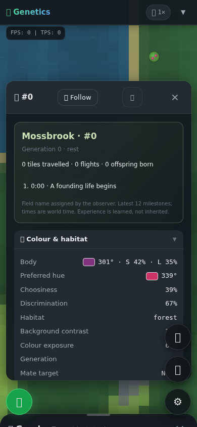

# Animals with a past: implementation and evidence

## What the last PR made possible

Merged PR #144 preserves inherited alternatives and gives vigilance a real ecological cost. Its evidence explicitly does not establish sustained natural adaptation or resolve the subjective experience of watching the world. This continuation adds individual learned history and makes factual lives visible.

An animal can remember a dangerous place, choose a different roaming route, have children, die, and leave living relatives that the observer can follow. Names are field labels, not invented personality. No rescue, assigned fitness, forced births or habitat-directed inheritance is added.

## Implemented

- At most three copied personal danger sites; 45-second default retention, fading strength, zero-disable editor control. Only visible predators within the animal's accepted escape state teach a site. Social alarms alone cannot teach one.
- Reachable discretionary routes are ranked by remembered segment exposure. All-risky routes remain usable. Water/food/mating and social reunion retain authority; experienced danger invalidates an old exploration goal. Memories stay individual and are not inherited.
- A field notebook in the inspector: stable observer name, generation, distance travelled, flight episodes, offspring count, parent IDs, living-family buttons and twelve recent factual milestones.
- Exact death causes from the death system and 128 recent copied memorials. A living-child button continues camera following after a parent's death. Posthumous births update retained parental records.
- World-time event timestamps survive TPS changes; reset replaces all records. Simulation observation is separate from rendering and consumes no randomness.

## Verification

`npm run verify` passed all 320 pre-existing tests and the first six new tests (326 total), lint, formatting and production build. Two additional targeted cases then passed with the complete eight-test new suite: all-danger route fallback, bounded milestones and TPS edits. Final lint/format checks include the added tooling and documentation. No production source changed after full verification.

Three 3,600-tick comparisons against merged `48297bf`, with place memory disabled, match all ecological creature fields, metrics and runtime RNG outputs exactly after removing only the new passive story/experience fields. Repeated observation and inspector rendering cannot change ecological state. The raw [passive checks](evidence/passive.jsonl) and reusable runner preserve this result.

Real Chromium 153 at 1280×900 and 390×844 verified selection, passive inspector reads, authoritative injury memorial, living-child camera follow, 44px family tap targets, no horizontal card overflow, and reset clearing. Zero page errors. The death/child interaction uses an explicit lifecycle fixture; screenshots show ordinary default-world inspection at 120 ticks. This is viewport emulation, not physical-phone certification. [Browser results](evidence/browser/results.json).

## Ordinary ecology: six 36,000-tick runs

Three predefined seeds, paired memory off/on, 120×160 default world, 80 founders, 60 TPS: **216,000 total ticks**, ten simulated minutes per world. Every tick checks finite positions/meters, bounds, population accounting, three-site/twelve-event/128-memorial limits. All six runs passed. These are descriptive trajectories, not an estimate of long-run equilibrium or proof of adaptive evolution.

| Seed | Births off → on | Predation deaths off → on | Final square/circle/triangle/octagon off → on | Cautious actor-second samples on |
| ---- | --------------- | ------------------------- | --------------------------------------------- | -------------------------------- |
| 1    | 168 → 182       | 27 → 24                   | 86/63/3/4 → 86/73/7/2                         | 4235                             |
| 42   | 166 → 157       | 31 → 25                   | 57/86/4/4 → 63/78/3/4                         | 3603                             |
| 1337 | 151 → 173       | 26 → 36                   | 70/62/4/2 → 67/75/6/10                        | 4209                             |

The consequences differ by world: seed 42 has fewer predation deaths and fewer births, while seed 1337 has more of both and more surviving predators. This is not a universal survival improvement. Controlled tests establish that remembered danger changes route choice; later ecological differences also include changed RNG consumption and cascading interactions. These endpoint pairs cannot isolate every causal pathway.

“Cautious samples” count once per simulated second per living animal when a discretionary goal was chosen after encountering remembered exposure, while actually wandering/grazing and not fleeing. They are not unique animals, successful evasions, or route length saved. World lifetime counters and hashes are in the six raw JSONL rows. Elapsed times were measured during concurrent runs with tests/browser work and must not be used as comparative performance benchmarks.

## Provenance and reproduction

Production source was unchanged throughout the runs and matches published source commit `116942249cf222805de509d13761425d1c59762c` (tree `3b90e3cdf2f306cd476a4070fc7c25c2e209684a`). Runs began in the local working tree before that identical tree was published. The manifest supplies SHA-256 hashes of every source file and each evidence artifact; it is an archive checksum, not independent attestation of execution. Protocol defaults are archived; only seed and `creatureDangerMemorySeconds` vary between the ordinary treatments. Node 24.22.1, Linux x64.

```sh
npm ci
npm run verify
node scripts/verify-lived-experience.mjs 1 36000
node scripts/verify-lived-experience.mjs 42 36000
node scripts/verify-lived-experience.mjs 1337 36000
git worktree add --detach /tmp/genetics-baseline 48297bf
node scripts/verify-lived-passive.mjs /tmp/genetics-baseline
PLAYWRIGHT_MODULE=/path/to/playwright BROWSER_EXECUTABLE=/path/to/chromium node scripts/verify-lived-experience-browser.cjs
```

Playwright and Chromium are external validation tools, not repository dependencies. The usual browser download failed in this environment; Chromium was obtained through the `@sparticuz/chromium` package and its binary used for the successful run.

## Limits and next questions

This makes acquired history consequential and observable. It does not prove that the original evolutionary vision is achieved. Only herbivores using the existing herd escape system learn these danger sites; predators retain their existing pack/search behavior. Social following can outweigh place caution. The notebook is bounded, not a complete genealogy: old memorials and old milestones are evicted, and family buttons show up to eight living direct relatives. No multi-generation selection assay, new full-engine performance benchmark, physical mobile test or automatic dynasty continuation is claimed.


